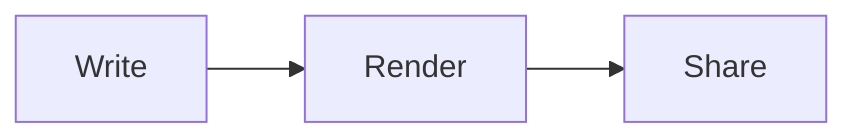
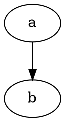
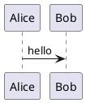

# MarkupMe

Markdown processing and document engineering: a standards-first engine, one CLI for the whole workflow, diagrams as code, safe HTML by default, and editor integrations.

MarkupMe turns Markdown files into readable, safe, well-structured documents. Writing docs usually means five or six tools: a renderer, a linter, a formatter, a TOC generator, a diagram tool and a docs site generator, each with its own config. MarkupMe does all of that with one `markupme` command and one config file. It is built on unified/remark (CommonMark + GFM), sanitizes HTML by default, renders Yarlis Blueprint, Graphviz and Mermaid diagrams without a CDN, and says plainly what is built, opt-in and planned. MIT licensed.

> [!NOTE]
> **Not on npm yet.** The `@markupme/*` packages are published when the first release is tagged. Until then, [install from source](#from-source).

## Contents

- [Features](#features)
- [Install](#install)
- [Quick start (5 minutes)](#quick-start-5-minutes)
- [CLI](#cli)
- [Markdown syntax](#markdown-syntax)
- [Diagrams](#diagrams)
- [Preview server and HTTP API](#preview-server-and-http-api)
- [SDK](#sdk)
- [Packages](#packages)
- [Security](#security)
- [Editors](#editors)
- [Testing](#testing)
- [Documentation](#documentation)
- [Roadmap](#roadmap)
- [Contributing and licence](#contributing-and-licence)

## Features

Status as reported by `markupme capabilities`. Work in progress is listed as planned until its pull request merges.

| Area | Feature | Status |
| ---- | ------- | ------ |
| Syntax | CommonMark | built |
| Syntax | GFM tables, task lists, strikethrough, autolinks, footnotes | built |
| Syntax | YAML / TOML frontmatter | built |
| Syntax | GitHub alerts (`> [!NOTE]`) | built |
| Syntax | Directives (`:::callouts`, `:::details`, `::toc`, `:kbd[]`, `:abbr[]`, `:badge[]`) | built |
| Syntax | Heading ids with `{#custom-id}` | built |
| Syntax | Math (KaTeX) | opt-in: `--math` |
| Syntax | Emoji shortcodes | opt-in: `--emoji` |
| Output | HTML (sanitized by default) | built |
| Output | Standalone HTML page (themes, dark mode, print CSS) | built |
| Output | Markdown (normalized, round-trip checked) | built |
| Output | JSON AST (mdast + schemaVersion) | built |
| Output | Plain text | built |
| Output | Static documentation site (`markupme build`) | built |
| Output | React elements (`@markupme/react`) | planned (in progress, Phase 1) |
| Output | PDF, DOCX, MDX | planned (CLI exits 64) |
| Diagrams | Mermaid (flowchart, sequence, state, class, ER, Gantt, C4 …), rendered in the browser | built |
| Diagrams | Yarlis Blueprint (`ybp`) | built |
| Diagrams | Graphviz DOT (WebAssembly) | built |
| Diagrams | PlantUML, C4-PlantUML, Structurizr, D2 … via Kroki | opt-in: `--diagram-server <url>` |
| Tools | Lint rules with stable codes | built |
| Tools | Formatter | built |
| Tools | TOC insert / refresh | built |
| Tools | Live preview server with a render API | built |
| Tools | Structural diff | built |
| Editor | Web studio (CodeMirror 6, split preview) | planned (in progress, Phase 1) |
| Editor | VS Code extension | planned (in progress, Phase 1) |
| Editor | Rich-text (WYSIWYG) editing | planned |

## Install

### From npm (after the first release)

```bash
npm i -g @markupme/cli
markupme --version        # 0.1.0
```

### From source

```bash
git clone https://github.com/YarlisAISolutions/markupme.git
cd markupme
bun install
bun run build
node packages/cli/dist/bin.js --help
```

Requirements: Node.js 22 or later; Bun 1.4 for development. Optional: `playwright` with Chromium, only for exporting Mermaid diagrams to SVG files.

In the examples below, `markupme` means either the global command or `node packages/cli/dist/bin.js`.

## Quick start (5 minutes)

**1. Create a config and a sample document.**

```console
$ markupme init
created markupme.config.json
created docs/welcome.md
next: markupme serve docs
```

**2. Preview it with live reload.**

```console
$ markupme serve docs
markupme 0.1.0 serving docs at http://127.0.0.1:4321
  playground  http://127.0.0.1:4321/__markupme/playground
  api         http://127.0.0.1:4321/api/health · POST /api/render · POST /api/validate
```

Open the URL. Edit `docs/welcome.md` and the page reloads. The playground lets you type Markdown and see the result.

**3. Render a standalone page.**

```console
$ markupme render docs/welcome.md --standalone -o out/welcome.html
wrote out/welcome.html
```

`out/welcome.html` is a full page with styles and a dark-mode toggle (fenced code blocks also get copy buttons). The sample has a Mermaid diagram, so `out/assets/mermaid.min.js` is copied next to it. No CDN.

**4. Lint.**

```console
$ markupme validate docs
✓ 1 file: 0 errors, 0 warnings, 0 info
```

A file with problems:

```console
$ markupme lint bad.md
bad.md:5:1 warning MM005 Image "shot.png" has no alt text (image-alt-text)
bad.md:5:1 error MM012 File not found: shot.png (missing-local-file)
bad.md:7:1 error MM004 Link target "#nowhere" does not exist in this document (broken-fragment-link)
bad.md:9:1 warning MM001 Heading level jumps from h2 to h4 (heading-increment)
✗ 1 file: 2 errors, 2 warnings, 0 info
```

Exit code 1, so CI fails. In GitHub Actions each problem also becomes an annotation.

**5. Build a site.**

```console
$ markupme build docs -o site
built 1 page into site
```

`site/` has `index.html`, one page per Markdown file, `markupme.css`, `search-index.json` and `assets/`.

## CLI

Every command takes `--help`. The full reference, with every flag, is [docs/guide/cli.md](docs/guide/cli.md).

| Command | Purpose |
| ------- | ------- |
| `init` | Create `markupme.config.json` and `docs/welcome.md`. |
| `render` | Render files or stdin to `html`, `md`, `ast` or `text`. |
| `validate` (`lint`) | Lint structure, links, accessibility, frontmatter, directives. |
| `format` (`fmt`) | Normalize Markdown formatting; content is never dropped. |
| `toc` | Insert or refresh a `<!-- toc -->` table of contents. |
| `build` | Build a static site with navigation and search. |
| `serve` (`preview`) | Live preview, playground and JSON API. |
| `diagram` | List or export a file's diagrams as SVG. |
| `parse` | Print the document model (JSON AST) or the heading outline. |
| `stats` | Word count, reading time and structure. |
| `diff` | Block-level diff of two Markdown files. |
| `capabilities` | What is built, opt-in and planned; the lint rules. |

### Shared flags

Feature flags (most commands): `-c, --config <file>`, `--no-gfm`, `--no-frontmatter`, `--no-directives`, `--no-alerts`, `--math`, `--emoji`, `--no-heading-ids`, `--toc [marker|top|after-title]`, `--toc-depth 2-3`.

Render flags (`render`, `build`, `serve`): `--theme light|dark|auto`, `--no-sanitize`, `--no-html`, `--no-anchors`, `--no-highlight`, `--line-numbers`, `--diagrams <list>`, `--diagram-server <url>`, `--base-url <url>`, `--external-new-tab`.

### init

Key flags: `--force` (overwrite the config), `--no-sample`.

```bash
markupme init
markupme init --force --no-sample
```

### render

Key flags: `-f, --format html|md|ast|text`, `-o, --output`, `-s, --standalone`, `--inline-assets`, `--assets-dir`, `--mermaid-url`, `-w, --watch`, `--strict`, `--json`, `-q, --quiet`.

```bash
markupme render README.md                                   # HTML fragment to stdout
markupme render docs -o out                                 # a whole folder
markupme render notes.md -s --inline-assets -o notes.html   # one offline file
```

```console
$ printf '> [!TIP]\n> Run `markupme serve`.\n\nPress :kbd[Ctrl] + :kbd[K].\n' | markupme render --no-highlight
<div class="markdown-alert markdown-alert-tip" role="note">
<p class="markdown-alert-title">Tip</p>
<p>Run <code>markupme serve</code>.</p>
</div>
<p>Press <kbd>Ctrl</kbd> + <kbd>K</kbd>.</p>
```

### validate

Key flags: `--strict`, `--json`, `-r, --rule name=level`, `--no-check-links`, `--check-diagrams`, `-q, --quiet`.

```bash
markupme validate docs --strict
markupme lint README.md -r single-h1=off -r MM013=warning
markupme validate . --check-diagrams --json > lint.json
```

### format

Key flags: `--write`, `--check`, `--bullet - * +`, `--emphasis _ *`.

```console
$ markupme format f.md --check
would reformat f.md
✗ 1 file need formatting
$ markupme format f.md
- a
- b

_x_
```

```bash
markupme fmt docs --write
```

### toc

Key flags: `--write`, `--check`, `--position after-title|top`.

```console
$ markupme toc guide.md --check
✗ table of contents in guide.md is out of date
$ markupme toc guide.md --write
updated table of contents in guide.md
$ markupme toc guide.md --check
✓ table of contents is up to date
```

### build

Key flags: `-o, --output <dir>` (default `site`), `--name <name>`, `--no-clean`, `--strict`.

```bash
markupme build docs -o site --name "Team docs"
markupme build . --strict --diagram-server http://localhost:8000
```

### serve

Key flags: `-p, --port` (default 4321, `0` = any), `--host` (default `127.0.0.1`), `--cors <origin>`, `--unsafe`, `--no-live-reload`.

```bash
markupme serve docs
markupme preview README.md --port 0
markupme serve examples --port 4321 --cors http://localhost:5173
```

### diagram

Key flags: `-o, --output <dir>`, `--list`, `--diagrams <list>`, `--diagram-server <url>`.

```console
$ markupme diagram d.md --list
1. blueprint (ybp) line 1
2. graphviz (dot) line 8
2 diagrams in d.md (use -o <dir> to export SVG)
$ markupme diagram d.md -o svg
wrote svg/d-1-ybp.svg
wrote svg/d-2-dot.svg
2 diagrams exported
```

### parse

Key flags: `--outline`, `--no-positions`.

```console
$ markupme parse docs/welcome.md --outline
- Welcome to MarkupMe (#welcome-to-markupme, line 5)
  - Write (#write, line 9)
  - Draw (#draw, line 16)
  - Check (#check, line 23)
```

```bash
markupme parse README.md --no-positions > ast.json
```

### stats

Key flag: `--json`.

```console
$ markupme stats docs/welcome.md
docs/welcome.md
  49 words, ~1 min read, 4 headings, 3 links, 0 images, 0 tables, 1 code blocks, 1 footnotes
  tasks: 1/2 done
  code: mermaid×1
```

### diff

Key flag: `--json`. Exit 1 when the files differ.

```console
$ markupme diff a.md b.md
~ paragraph (line 3): old → new
+ heading (line 5): Added
```

### capabilities

```bash
markupme capabilities
markupme capabilities --json
```

### Exit codes

| Code | Meaning |
| ---: | ------- |
| 0 | Success |
| 1 | Validation errors (or warnings with `--strict`); `format --check` or `toc --check` found changes; `diff` found differences; a diagram export failed |
| 2 | Bad arguments, options or config file |
| 3 | Rendering or file I/O failed |
| 64 | Planned but not built: `render -f pdf`, `-f docx`, `-f mdx`; Mermaid SVG export without `playwright` |

### markupme.config.json

Read from the working directory, or pass `-c <file>`. Defaults, then the file, then the flags you typed.

```json
{
  "gfm": true,
  "frontmatter": true,
  "directives": true,
  "alerts": true,
  "math": false,
  "emoji": false,
  "headingIds": true,
  "toc": { "minDepth": 2, "maxDepth": 3 },
  "render": {
    "sanitize": true,
    "anchors": true,
    "highlight": true,
    "lineNumbers": false,
    "theme": "auto"
  },
  "diagrams": { "providers": ["blueprint", "graphviz", "mermaid"] },
  "rules": { "single-h1": "off" },
  "site": { "name": "Docs", "exclude": ["drafts"] }
}
```

Add `"diagrams": { "server": "http://localhost:8000" }` to turn on Kroki. All fields are in [docs/guide/cli.md](docs/guide/cli.md#configuration-file).

## Markdown syntax

The full guide with every option is [docs/guide/syntax.md](docs/guide/syntax.md).

| Write | Get |
| ----- | --- |
| `> [!WARNING]`<br>`> Be careful.` | `<div class="markdown-alert markdown-alert-warning" role="note">` with a "Warning" title. Also `NOTE`, `TIP`, `IMPORTANT`, `CAUTION`. |
| `:::tip[Pro tip]`<br>`Body`<br>`:::` | `<div class="mm-callout mm-callout-tip" role="note">` with a "Pro tip" title. Also `note info important warning caution danger success`. |
| `:::details[More]{open}`<br>`Hidden`<br>`:::` | `<details open><summary>More</summary>…</details>` |
| `:::figure[Caption]`<br>``<br>`:::` | `<figure class="mm-figure">…<figcaption>Caption</figcaption></figure>` |
| `::::columns` / `:::column` … | `<div class="mm-columns"><div class="mm-column">…` (outer fence has more colons) |
| `:kbd[Ctrl]` `:mark[x]` `:sub[2]` `:sup[2]` | `<kbd>`, `<mark>`, `<sub>`, `<sup>` |
| `:abbr[HTML]{title="HyperText Markup Language"}` | `<abbr title="…">HTML</abbr>` |
| `:badge[New]{type=success}` | `<span class="mm-badge mm-badge-success">New</span>` |
| `[[toc]]`, `::toc` or `<!-- toc -->` | `<nav class="mm-toc" aria-label="Table of contents">` with links to h2–h3 |
| `## Setup {#install}` | `<h2 id="install">Setup</h2>` |
| `Text.[^1]` … `[^1]: Note.` | Footnote reference and a footnotes section, linked both ways |
| `- [x] Done` | `<input type="checkbox" checked disabled aria-label="Completed task: Done">` |
| `$e^{i\pi}+1=0$` (with `--math`) | KaTeX output |
| `:rocket:` (with `--emoji`) | 🚀 |

Code fences take `title="app.ts"`, `{1,3-5}` (highlight lines), `showLineNumbers` and `startLine=10`. Unknown directives are kept, rendered as `mm-directive-<name>`, and reported as `MM009`. Prose like `10:30` stays text.

Diagram fences:

````markdown




```ybp
flowchart "Flow"
api: API [service]
db: DB [database]
api -> db
```


````

- `mermaid` becomes `<pre class="mermaid">` inside `<figure class="mm-diagram mm-diagram-mermaid">`, rendered by the page.
- `dot` and `ybp` become inline SVG inside `<figure class="mm-diagram mm-diagram-graphviz">` / `mm-diagram-blueprint`.
- `plantuml` renders through Kroki when you pass `--diagram-server`. Without a server it stays a plain code block.

## Diagrams

| Provider | Fence languages | Renders | Default |
| -------- | --------------- | ------- | ------- |
| Yarlis Blueprint (`@bpview/core`) | `ybp`, `blueprint`, `blueprint-yaml` | Server, SVG | on |
| Graphviz (`@hpcc-js/wasm-graphviz`) | `dot`, `graphviz` | Server, SVG, WebAssembly, no system binary | on |
| Mermaid | `mermaid` | Browser (page runtime, `securityLevel: 'strict'`) | on |
| Kroki | `plantuml`, `puml`, `c4plantuml`, `c4`, `structurizr`, `d2`, `ditaa`, `erd`, `nomnoml`, `bpmn`, `bytefield`, `excalidraw`, `pikchr`, `svgbob`, `vega`, `vegalite`, `wavedrom` | Kroki server, SVG | off |

All SVG is sanitized before it goes into the page. A broken diagram becomes an error box plus an `MM040` diagnostic; the rest of the page still renders. Results are cached by SHA-256 of the source.

Turn on Kroki (this sends diagram source to that server, so prefer a self-hosted one):

```bash
docker run -d -p 8000:8000 yuzutech/kroki
markupme render c4.md -s -o c4.html --diagram-server http://localhost:8000
```

Pick providers with `--diagrams blueprint,graphviz`, or `--diagrams none`. Mermaid uses a local copy of `mermaid.min.js` by default; `--mermaid-url <url>` uses a URL you choose. Exporting Mermaid to SVG files (`markupme diagram -o`) needs `npm i -D playwright && npx playwright install chromium`.

## Preview server and HTTP API

`markupme serve [path]` binds `127.0.0.1:4321` and serves:

| Route | What |
| ----- | ---- |
| `/`, `/<file>.md` | Rendered pages with live reload and a diagnostics banner |
| `/__markupme/playground` | Type Markdown, see HTML and diagnostics |
| `GET /api/health` | Health |
| `GET /api/capabilities` | The capabilities table |
| `POST /api/render` | Render Markdown |
| `POST /api/validate` | Lint Markdown |
| `POST /api/stats` | Count things |

```console
$ curl -s localhost:4321/api/health
{"status":"ok","name":"markupme","version":"0.1.0"}

$ curl -s localhost:4321/api/render -H 'Content-Type: application/json' \
    -d '{"markdown":"# Hi\n\n> [!TIP]\n> Works"}'
{"format":"html","title":"Hi","output":"<h1 id=\"hi\">Hi<a class=\"mm-anchor\" href=\"#hi\" aria-label=\"Link to section: Hi\">#</a></h1>\n<div class=\"markdown-alert markdown-alert-tip\" role=\"note\">\n<p class=\"markdown-alert-title\">Tip</p>\n<p>Works</p>\n</div>","diagnostics":[],"stats":{"words":3,"characters":14,"readingMinutes":1,"headings":1,"paragraphs":1,"links":0,"images":0,"tables":0,"codeBlocks":0,"footnotes":0,"tasks":{"total":0,"done":0},"languages":{}}}

$ curl -s localhost:4321/api/validate -H 'Content-Type: application/json' -d '{"markdown":"[x](#y)"}'
{"ok":false,"errors":1,"warnings":0,"diagnostics":[{"code":"MM004","rule":"broken-fragment-link","severity":"error","message":"Link target \"#y\" does not exist in this document","line":1,"column":1}]}

$ curl -s localhost:4321/api/stats -H 'Content-Type: application/json' -d '{"markdown":"# T\n\n- [x] a\n- [ ] b"}'
{"words":3,"characters":3,"readingMinutes":1,"headings":1,"paragraphs":2,"links":0,"images":0,"tables":0,"codeBlocks":0,"footnotes":0,"tasks":{"total":2,"done":1},"languages":{}}

$ curl -s localhost:4321/api/render -H 'Content-Type: application/json' -d '{"markdown":"x","format":"pdf"}'
{"error":{"code":"UNSUPPORTED","message":"Format \"pdf\" is planned, not built"}}
```

Request body: `markdown` (required), plus optional `format` (`html`, `markdown`, `ast`, `text`), `toc`, `math`, `emoji`, `anchors`, `highlight`, `lineNumbers`, `diagrams`, `standalone`, `sanitize`, and `lint` (`/api/render` only: also run the lint rules and include their diagnostics, as the playground does). `sanitize: false` only works when the server was started with `--unsafe`. Errors are `{"error":{"code","message"}}` with 400, 404, 405, 413 (body over 1 MB), 500 or 501. Details in [docs/guide/cli.md](docs/guide/cli.md#serve).

## SDK

```ts
import { createProcessor, formatDiagnostic, type MarkupMePlugin, query } from '@markupme/core'
import { diagramHandler } from '@markupme/diagrams'
import { highlightHandler } from '@markupme/highlight'
import { wrapDocument } from '@markupme/themes'

// A plugin with one lint rule.
const noTodo: MarkupMePlugin = {
  name: 'no-todo',
  rules: [
    {
      code: 'X001',
      name: 'no-todo',
      description: 'No TODO markers in published docs.',
      severity: 'warning',
      check({ doc, report }) {
        for (const t of query(doc.tree, 'text'))
          if (t.value.includes('TODO')) report({ message: 'TODO left', line: t.position?.start.line })
      },
    },
  ],
}

const processor = createProcessor({ math: true, plugins: [noTodo] })
const doc = processor.parse(source, { file: 'guide.md' })

// Lint: built-in rules plus the plugin rule.
for (const d of processor.validate(doc)) console.error(formatDiagnostic(d))

// Render: sanitized HTML, diagrams first, then highlighting for everything else.
const diagrams = diagramHandler()
const result = await processor.render(doc, {
  anchors: true,
  codeBlocks: [diagrams, highlightHandler({ skip: diagrams.langs })],
})

const page = wrapDocument({ body: result.output, title: result.title, theme: 'auto' })
```

`parse`, `transform`, `serialize` and `validate` are synchronous; `render` is async. Each processor is isolated (no global plugin registry). Also available: `transform(doc, { plugins: ['toc'] })`, `serialize(doc)`, `processor.roundTrip(doc)`, `query`, `visit`, `outline`, `diff`, `stats`. Full API: [docs/guide/sdk.md](docs/guide/sdk.md).

## Packages

| Package | What | Status |
| ------- | ---- | ------ |
| [`@markupme/core`](packages/core) | Parse, document model, safe HTML, Markdown/AST/text output, lint rules, TOC, diff, stats. Browser-safe. | built |
| [`@markupme/highlight`](packages/highlight) | Shiki highlighting: light/dark themes, titles, line numbers, line highlights, copy buttons | built |
| [`@markupme/diagrams`](packages/diagrams) | Diagram providers (Blueprint, Graphviz, Mermaid, Kroki), SVG sanitizer, cache | built |
| [`@markupme/themes`](packages/themes) | CSS (light, dark, print), page runtime, `wrapDocument` | built |
| [`@markupme/cli`](packages/cli) | The `markupme` command and preview server | built |
| `apps/studio` | Web studio (Vite + CodeMirror 6) | planned (in progress on `feat/studio`) |
| `packages/vscode` | VS Code extension | planned (in progress on `feat/vscode`) |
| `@markupme/react` | React component | planned (in progress, Phase 1) |

All packages are version 0.1.0, ESM-only, MIT, and publishable on their own.

## Security

- HTML is sanitized by default with GitHub's schema plus a small allowlist of MarkupMe tags, ARIA attributes and classes. Scripts, styles, iframes, forms, event handlers and `javascript:` URLs are removed.
- Highlighting, diagrams and KaTeX are added after sanitizing through placeholders with a random nonce, so they cannot be forged by the document.
- Ids written by authors keep the `user-content-` prefix (DOM clobbering protection); only ids MarkupMe generated lose it.
- Diagram SVG goes through its own sanitizer.
- No network by default: no CDN, no Kroki unless you configure it.
- The preview server binds `127.0.0.1`, blocks path traversal, limits bodies to 1 MB, and ignores `sanitize: false` unless started with `--unsafe`.

Details: [docs/guide/security.md](docs/guide/security.md). Report vulnerabilities privately: [SECURITY.md](SECURITY.md).

## Editors

Both are being built now in Phase 1, on the branches `feat/studio` and `feat/vscode`. Until they merge, `markupme capabilities` lists them as planned (in progress).

- **Studio** (`apps/studio`): a browser editor built with Vite and CodeMirror 6. Source, split and preview modes, an outline, a command palette, local autosave and export. It renders with `@markupme/core`, so output matches the CLI. Rich-text editing is planned for Phase 2 ([ADR 0007](docs/architecture/architecture-decision-records/0007-codemirror-studio-editor.md)).
- **VS Code extension** (`packages/vscode`): preview in a webview, export HTML, insert TOC, format, and diagnostics in the Problems panel. A Marketplace listing is planned for Phase 2.

Until they land, `markupme serve` plus its playground is the live preview.

## Testing

Unit tests use vitest, one `test/` folder per package. On `main`: core 40, highlight 4, diagrams 7, themes 3, cli 18 (71 in total).

```bash
bun run lint:check && bun run build && bun run type-check && bun run test
```

End-to-end tests use [SDODS](https://github.com/YarlisAISolutions/sdods) in a separate repository, [YarlisAISolutions/markupme-qa](https://github.com/YarlisAISolutions/markupme-qa), against `markupme serve examples --port 4321`:

| Feature | Layer | Scenarios |
| ------- | ----- | --------- |
| Preview server health | api | 2: health, honest capabilities |
| Render API | api | 12: GFM, footnotes/alerts/directives/ids, TOC, diagrams, broken diagram, sanitizing, md/text/ast formats, 400, 501, 405 |
| Validate and stats API | api | 3: problems reported, clean document, stats |
| Playground | ui | 5: loads with Mermaid, typing updates preview, diagnostics, accessibility (axe-core), dark mode |
| Rendered pages | ui | 5: kitchen sink, server and browser diagrams, sanitizing, accessibility, in-page links |

Last results: api 17/17 and ui 10/10, locally and in GitHub Actions; `sdods lint --strict` is clean. Studio scenarios come with the studio.

```bash
# terminal 1, in this repo
node packages/cli/dist/bin.js serve examples --port 4321

# terminal 2, in markupme-qa
bun install
bun run lint          # sdods lint -p markupme --strict
bun run test:api      # sdods run -p markupme -e local -l api
bun run test:ui       # sdods run -p markupme -e local -l ui -b chromium -t @smoke
```

### CI

| Workflow | What it runs |
| -------- | ------------ |
| `.github/workflows/ci.yml` › `test` | Biome CI, build, type-check, unit tests, `validate examples --strict --check-diagrams`, a determinism diff of render, AST and build output, `npm pack --dry-run` |
| `.github/workflows/ci.yml` › `e2e` | Builds MarkupMe, starts `markupme serve examples --port 4321`, runs the markupme-qa SDODS lint, api and ui suites, and fails below 15 api / 10 ui scenarios |
| `.github/workflows/ci.yml` › `gitleaks` | Secret scan |
| `.github/workflows/security.yml` | Org security suite (Yarlis Bastion), also weekly |
| `.github/workflows/release.yml` | Publishes `@markupme/*` in dependency order with npm provenance when versions bump |

markupme-qa also runs the suites on its own pull requests and nightly.

## Documentation

| Document | What |
| -------- | ---- |
| [docs/guide/cli.md](docs/guide/cli.md) | Full CLI reference |
| [docs/guide/syntax.md](docs/guide/syntax.md) | Every supported syntax feature |
| [docs/guide/sdk.md](docs/guide/sdk.md) | Programmatic API |
| [docs/guide/security.md](docs/guide/security.md) | Threat model and sanitizing |
| [docs/product/PRD.md](docs/product/PRD.md) | Product requirements |
| [docs/product/BRD.md](docs/product/BRD.md) | Business requirements |
| [docs/product/FRD.md](docs/product/FRD.md) | Functional requirements (FR-xxx) |
| [docs/product/NFR.md](docs/product/NFR.md) | Non-functional requirements (NFR-xxx) |
| [docs/product/acceptance-criteria.md](docs/product/acceptance-criteria.md) | Acceptance criteria (AC-xxx) |
| [docs/implementation/implementation-plan.md](docs/implementation/implementation-plan.md) | Phases, risks and mitigations |
| [docs/implementation/requirements-traceability.md](docs/implementation/requirements-traceability.md) | Requirement → code → test → status |
| [docs/research/competitive-analysis.md](docs/research/competitive-analysis.md) | Comparison with marked, markdown-it, remark and others |
| [docs/architecture/architecture-decision-records/](docs/architecture/architecture-decision-records/README.md) | ADRs 0001–0008 |
| [CONTRIBUTING.md](CONTRIBUTING.md) | How to contribute |
| [SECURITY.md](SECURITY.md) | Reporting vulnerabilities |
| [CHANGELOG.md](CHANGELOG.md) | Changes per release |

## Roadmap

| Phase | Scope | Status |
| ----- | ----- | ------ |
| Phase 1, PR#1 | Core, highlight, diagrams, themes, CLI, serve API, CI; SDODS api and ui suites | Merged |
| Phase 1, PR#2 | Web studio; SDODS studio scenarios | In progress (`feat/studio`) |
| Phase 1, PR#3 | VS Code extension; React component | In progress (`feat/vscode`) |
| Phase 2 | PDF, DOCX, MDX output; rich-text editing; VS Code Marketplace | Planned |

Full plan: [docs/implementation/implementation-plan.md](docs/implementation/implementation-plan.md). The first npm publish waits on rotating the npm token.

## Contributing and licence

Contributions are welcome. Read [CONTRIBUTING.md](CONTRIBUTING.md) first: feature branch plus pull request, Conventional Commits, and the four checks above green before review.

MIT. See [LICENSE](LICENSE).
