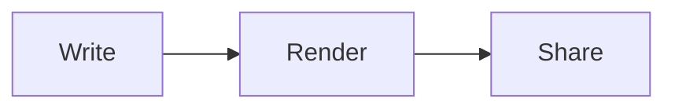
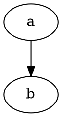
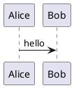

# Syntax guide

Everything MarkupMe parses and renders, with examples. The behaviour described here comes from `packages/core/src` (parser and transforms), `packages/highlight/src` (code fences) and `packages/diagrams/src` (diagram fences). HTML snippets show what the renderer emits with default options.

## Contents

- [Defaults](#defaults)
- [CommonMark](#commonmark)
- [GitHub Flavored Markdown](#github-flavored-markdown)
- [Frontmatter](#frontmatter)
- [Heading ids](#heading-ids)
- [Table of contents](#table-of-contents)
- [GitHub alerts](#github-alerts)
- [Directives](#directives)
- [Math](#math)
- [Emoji](#emoji)
- [Code blocks](#code-blocks)
- [Diagrams](#diagrams)
- [Raw HTML](#raw-html)
- [Lint rules](#lint-rules)

## Defaults

| Feature | Default | Switch (`ProcessorOptions` / CLI) |
| ------- | ------- | --------------------------------- |
| GFM | on | `gfm` / `--no-gfm` |
| Frontmatter | on | `frontmatter` / `--no-frontmatter` |
| Directives | on | `directives` / `--no-directives` |
| Alerts | on | `alerts` / `--no-alerts` |
| Heading ids | on | `headingIds` / `--no-heading-ids` |
| TOC at markers | on | `toc` / `--toc`, `--toc-depth` |
| Math | off | `math` / `--math` |
| Emoji | off | `emoji` / `--emoji` |
| Syntax highlighting | on in the CLI | `--no-highlight` (library: add `highlightHandler`) |
| Diagrams | blueprint, graphviz, mermaid in the CLI | `--diagrams` (library: add `diagramHandler`) |

## CommonMark

The parser is `remark-parse` (micromark underneath), which implements CommonMark. Headings, paragraphs, block quotes, nested and ordered lists, fenced and indented code, links, images, reference links, hard breaks, escapes, entities and Unicode all follow the spec.

```markdown
# Heading

A paragraph with **strong**, _emphasis_, `code`, a [link](https://example.com "title")
and a [reference][ref].

> A block quote
> - with a list

1. First
2. Second
   - Nested

    indented code

[ref]: https://example.com
```

`--no-gfm` (or `gfm: false`) gives plain CommonMark.

## GitHub Flavored Markdown

Through `remark-gfm`: tables, task lists, strikethrough, autolinks and footnotes.

```markdown
| Feature | Status |
| :------ | -----: |
| Tables  |     on |

- [x] Done
- [ ] Open

~~struck~~ and a bare link https://example.com

Text with a footnote.[^1]

[^1]: The note. Links go both ways.
```

Task list items render as `<input type="checkbox" checked disabled aria-label="Completed task: Done">` (or `"Open task: …"`), so screen readers announce the item text. Footnote links use ids such as `fn-1` and `fnref-1` (MarkupMe removes the `user-content-` prefix from ids it generated; see [security.md](security.md#html-pipeline), step 7).

## Frontmatter

YAML between `---` lines or TOML between `+++` lines, only at the very start of the file.

```markdown
---
title: Release notes
description: What changed in 0.1.0
tags: [release]
---
```

```markdown
+++
title = "Release notes"
+++
```

- The parsed object is in `doc.frontmatter`.
- `title` becomes the render result's `title` (else the first h1). In standalone pages `description` becomes `<meta name="description">`.
- Invalid YAML/TOML, or a value that is not a mapping, is reported as `MM010 invalid-frontmatter` (error). Parsing never throws.

## Heading ids

Every heading gets a GitHub-compatible id from `github-slugger`. Duplicates get `-1`, `-2` suffixes and a `MM003 duplicate-heading-id` warning.

```markdown
# Hello World          → id="hello-world"
## Hello World         → id="hello-world-1"
## Setup {#install}    → id="install"
```

A trailing `{#custom-id}` sets the id. The id must start with a letter and may contain letters, digits, `_ : . -`. The marker is removed from the heading text and written back by the serializer, so `markupme format` keeps it.

With `anchors: true` (the CLI default) each heading gets a link: `<a class="mm-anchor" href="#install" aria-label="Link to section: Setup">#</a>`.

## Table of contents

Put a marker where the TOC should go. Each of these is replaced by a generated list:

```markdown
[[toc]]

[toc]

::toc

<!-- toc -->
(anything here is replaced)
<!-- tocstop -->
```

`<!-- /toc -->` also closes a block. Defaults: levels 2 to 3 (`toc.minDepth`, `toc.maxDepth`, or `--toc-depth 2-4`).

HTML output:

```html
<nav class="mm-toc" aria-label="Table of contents"><ul>
<li><a href="#one">One</a></li>
</ul></nav>
```

The `toc.title` option sets the `aria-label` of the `<nav>`; no visible heading is added. Without a marker, `toc.position` (`--toc top` or `--toc after-title`) inserts one at the top or after the first h1. An empty TOC is never inserted by position.

When serialized to Markdown, a TOC is written between `<!-- toc -->` and `<!-- tocstop -->`, so `markupme toc --write` can refresh it later and running it twice changes nothing.

## GitHub alerts

The five GitHub alert types, case-insensitive:

```markdown
> [!NOTE]
> Useful information.

> [!TIP]
> A better way.

> [!IMPORTANT]
> Must know.

> [!WARNING]
> Be careful.

> [!CAUTION]
> Risky.
```

HTML:

```html
<div class="markdown-alert markdown-alert-warning" role="note">
<p class="markdown-alert-title">Warning</p>
<p>Be careful.</p>
</div>
```

The marker stays in the tree, so the Markdown round trip writes `> [!WARNING]` back unchanged and GitHub still renders it.

## Directives

Generic directives from `remark-directive`. Three forms: container (`:::name`), leaf (`::name` on its own line) and text (`:name[label]{attrs}`). Attributes use `{key="value" #id .class}` syntax.

### Containers

Callouts: `note`, `tip`, `info`, `important`, `warning`, `caution`, `danger`, `success`.

```markdown
:::note
Body text.
:::

:::tip[Pro tip]
The label becomes the title.
:::

:::warning{title="Read first"}
A title attribute works too.
:::
```

```html
<div class="mm-callout mm-callout-tip" role="note"><p class="mm-callout-title">Pro tip</p><p>The label becomes the title.</p></div>
```

Without a label or title, the title is the capitalized name (`Note`).

Details (collapsible):

```markdown
:::details[Click to expand]
Hidden content.
:::

:::details[Open by default]{open}
Visible content.
:::
```

Renders `<details><summary>Click to expand</summary>…</details>`. Without a label the summary is `Details`.

Figure:

```markdown
:::figure[The caption]

:::
```

Renders `<figure class="mm-figure">…<figcaption>The caption</figcaption></figure>`.

Columns: the outer fence needs more colons than the inner ones.

```markdown
::::columns
:::column
Left
:::
:::column
Right
:::
::::
```

Renders `<div class="mm-columns"><div class="mm-column">…</div><div class="mm-column">…</div></div>`. With the same number of colons on both levels the first inner `:::` closes the outer block.

### Leaf directives

On a line of their own:

```markdown
::toc

::br
```

`::toc` places a table of contents. `::br` renders `<br>`. Inside a paragraph, `::br` stays literal text.

### Text directives

```markdown
Press :kbd[Ctrl] + :kbd[K].
:mark[Highlighted] text.
:abbr[HTML]{title="HyperText Markup Language"}
H:sub[2]O and E = mc:sup[2]
:badge[New]{type=success}
```

| Directive | HTML |
| --------- | ---- |
| `:kbd[Ctrl]` | `<kbd>Ctrl</kbd>` |
| `:mark[x]` | `<mark>x</mark>` |
| `:abbr[HTML]{title="..."}` | `<abbr title="...">HTML</abbr>` |
| `:sub[2]`, `:sup[2]` | `<sub>2</sub>`, `<sup>2</sup>` |
| `:badge[New]{type=success}` | `<span class="mm-badge mm-badge-success">New</span>` (type defaults to `default`) |

### Colons in prose

A text directive with no label and no attributes is turned back into text at parse time, so `Meeting at 10:30` and `note:this` stay as written.

### Unknown directives

Any other name is kept, never dropped. It renders as `<div class="mm-directive mm-directive-NAME">` (containers and leaves) or `<span class="mm-directive mm-directive-NAME">` (text), and the parser reports `MM009 unknown-directive` (warning).

## Math

Off by default. Turn on with `math: true` or `--math`. Uses `remark-math` and KaTeX.

```markdown
Inline $e^{i\pi} + 1 = 0$.

$$
\int_0^1 x^2 \, dx = \tfrac{1}{3}
$$
```

KaTeX runs with `throwOnError: false`, so bad TeX shows as an error span instead of failing the render. Standalone pages need the KaTeX stylesheet; the CLI copies it (and its fonts) into the assets folder or inlines the CSS.

## Emoji

Off by default. Turn on with `emoji: true` or `--emoji`. GitHub shortcodes from `gemoji`:

```markdown
Ship it :rocket: :tada:
```

Unknown names stay as written. Emoji are replaced at render time only, so the Markdown source and round trip keep the shortcodes.

## Code blocks

Highlighting is done by `@markupme/highlight` (Shiki), with dual light/dark themes (`github-light`, `github-dark` by default) through CSS variables.

Fence meta options:

````markdown
```ts title="hello.ts" {1,3-5} showLineNumbers startLine=10
const a = 1
const b = 2
const c = 3
const d = 4
const e = 5
```
````

| Meta | Effect |
| ---- | ------ |
| `title="..."`, `title='...'`, `title=x`, `filename=...` | Caption above the block (`<figcaption class="mm-code-title">`). |
| `{1,3-5}` | Highlight lines 1, 3, 4 and 5 (`mm-line-highlight`). |
| `showLineNumbers`, `lineNumbers`, `linenums` | Line numbers (`mm-line-numbers`). |
| `startLine=N` | First line number; turns line numbers on. |

Output is `<figure class="mm-code" data-lang="ts">` with an optional title, a copy button (`<button class="mm-copy" aria-label="Copy code">`) and the Shiki `<pre>`, which has `tabindex="0"` so keyboard users can scroll it.

Language aliases: `sh`, `shell`, `zsh` → bash; `js` → javascript; `ts` → typescript; `yml` → yaml; `md` → markdown; `py` → python; `rb` → ruby; `c++` → cpp; `c#`, `cs` → csharp; `ps1` → powershell; `dockerfile` → docker; `kt` → kotlin; `rs` → rust. Any other Shiki bundled language works by its own name. Unknown languages are escaped and shown as plain text, never dropped.

## Diagrams

Fenced code blocks whose language matches a diagram provider are replaced by the diagram. See [ADR 0005](../architecture/architecture-decision-records/0005-diagram-provider-interface.md).

| Fence language | Provider | Where it renders | Default |
| -------------- | -------- | ---------------- | ------- |
| `ybp`, `blueprint`, `blueprint-yaml` | Yarlis Blueprint (`@bpview/core`) | Server, SVG | on |
| `dot`, `graphviz` | Graphviz (`@hpcc-js/wasm-graphviz`, WebAssembly) | Server, SVG | on |
| `mermaid` | Mermaid | Browser | on |
| `plantuml`, `puml`, `c4plantuml`, `c4`, `structurizr`, `d2`, `ditaa`, `erd`, `nomnoml`, `bpmn`, `bytefield`, `excalidraw`, `pikchr`, `svgbob`, `vega`, `vegalite`, `wavedrom` | Kroki | Server, SVG, over the network | off; needs `--diagram-server <url>` |

````markdown





````

Output:

- Server diagrams: `<figure class="mm-diagram mm-diagram-graphviz" data-lang="dot" role="group" aria-label="graphviz diagram"><svg>…</svg></figure>`. The SVG is sanitized first.
- Mermaid: `<figure class="mm-diagram mm-diagram-mermaid" …><pre class="mermaid">source</pre></figure>`. The page runtime loads Mermaid (from a local copy by default) and renders it with `securityLevel: 'strict'`. Mermaid covers flowchart, sequence, state, class, ER, Gantt, C4, mindmap and other Mermaid diagram types.
- A diagram that fails renders an error box (`<div class="mm-diagram-error" role="alert">` with the message and the source) and a `MM040 diagram` error diagnostic. The rest of the page still renders.

When a language has both a diagram provider and a highlighter, the diagram wins: the CLI tells the highlighter to skip diagram languages.

## Raw HTML

Raw HTML in Markdown is parsed and then sanitized with the GitHub schema plus MarkupMe's additions. Safe tags such as `<details>`, `<summary>`, `<kbd>`, `<sub>` stay; `<script>`, `<style>`, `<iframe>`, `<form>`, event handlers, `style` attributes and `javascript:` URLs are removed. See [security.md](security.md).

- `--no-html` (`allowHtml: false`) drops raw HTML.
- `--no-sanitize` (`sanitize: false`) keeps everything. Only for trusted input.

## Lint rules

`markupme validate` (and `validate()` in the SDK) runs these. Codes are stable.

| Code | Rule | Default | Checks |
| ---- | ---- | ------- | ------ |
| MM001 | `heading-increment` | warning | Heading levels only increase by one. |
| MM002 | `single-h1` | warning | At most one h1. |
| MM004 | `broken-fragment-link` | error | `#id` links point to an existing heading, footnote or HTML `id`/`name`. |
| MM005 | `image-alt-text` | warning | Images have alt text. |
| MM006 | `empty-link` | warning | Links have a destination and text. |
| MM008 | `unused-definition` | info | Reference definitions are used. |
| MM012 | `missing-local-file` | error | Relative links and images point to files that exist. Needs a `fileExists` checker (the CLI supplies one). |
| MM013 | `code-block-language` | info | Fenced code blocks name a language. |
| MM015 | `unsafe-url` | error | No `javascript:`, `vbscript:` or `data:text/html` URLs. |
| MM016 | `empty-heading` | warning | Headings have text. |

Diagnostics raised elsewhere:

| Code | Rule | Source |
| ---- | ---- | ------ |
| MM003 | `duplicate-heading-id` | Parser (heading ids), warning. |
| MM009 | `unknown-directive` | Parser (directives), warning. |
| MM010 | `invalid-frontmatter` | Parser (frontmatter), error. |
| MM020 | `code-block-handler` | Renderer, when a code block handler throws; error. |
| MM030 | `toc` | `transform(['toc'])` found no place for a TOC; info. |
| MM031 | `round-trip` | `roundTrip()` found that serializing normalizes the document; info. |
| MM040 | `diagram` | Diagram handler, when a diagram fails; error. |

Set any of them with `rules` in the config or `-r name=level` on the command line, by name or by code.
