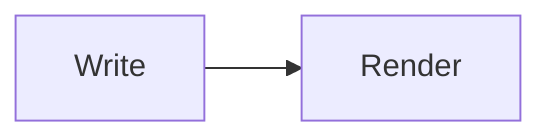
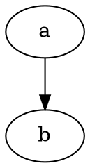

# MarkupMe kitchen sink

[[toc]]

## Text {#text-basics}

Plain, **strong**, _emphasis_, ~~strike~~, `code`, a [link](https://example.com), an autolink https://markupme.dev and a footnote.[^1]

Press :kbd[Ctrl] + :kbd[K]. Meeting at 10:30. :mark[Highlighted] and :abbr[HTML]{title="HyperText Markup Language"}.

## Lists

- [x] Done task
- [ ] Open task
  1. Nested ordered
  2. Second

## Table

| Feature | Status |
| :------ | -----: |
| GFM     |     on |
| Math    |    opt |

## Alerts and callouts

> [!NOTE]
> Useful information.

> [!WARNING]
> Be careful.

:::tip{title="Pro tip"}
Directives make **callouts**.
:::

:::details[Click to expand]
Hidden content.
:::

## Code

```ts title="hello.ts"
const greet = (name: string) => `Hello ${name}`
```

## Diagrams





## Raw HTML

<details><summary>Raw</summary>ok</details>
<script>alert('xss')</script>

[click](javascript:alert(1))

Back to [the top](#markupme-kitchen-sink) or [text basics](#text-basics).

[^1]: The footnote text.
