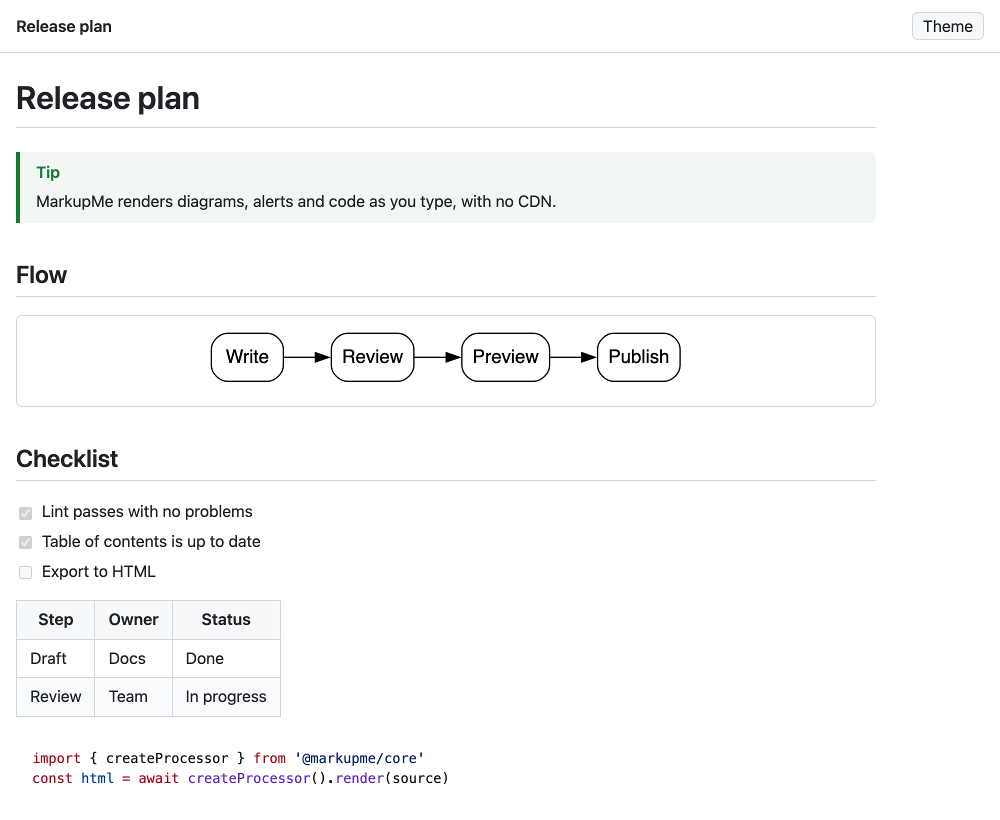
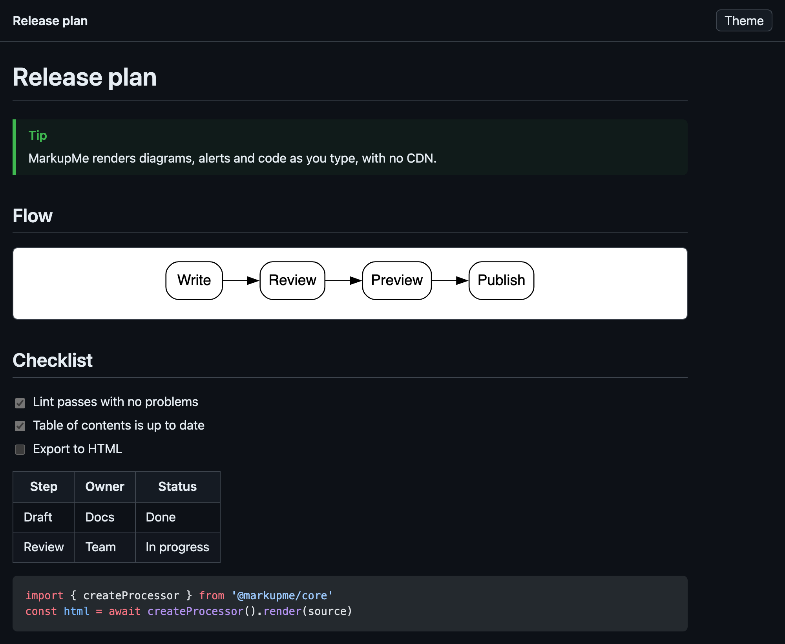

<p align="center">
  
</p>

<h1 align="center">MarkupMe for VS Code</h1>

<p align="center">
  Markdown preview with Mermaid, Graphviz and Blueprint diagrams, syntax highlighting, lint diagnostics, a table of contents, formatting and HTML export. Safe by default.
</p>

<p align="center">
  <a href="https://marketplace.visualstudio.com/items?itemName=yarlis.markupme-vscode"></a>
  <a href="https://marketplace.visualstudio.com/items?itemName=yarlis.markupme-vscode"></a>
  <a href="https://open-vsx.org/extension/yarlis/markupme-vscode"></a>
  <a href="https://github.com/YarlisAISolutions/markupme/blob/main/LICENSE"></a>
</p>



<details>
<summary>The same document in a dark theme</summary>



</details>

MarkupMe uses the same engine as the [`markupme` command line](https://github.com/YarlisAISolutions/markupme), so what you see in the editor is what your docs build and CI produce.

## Why MarkupMe

| | Built-in Markdown support | MarkupMe |
| --- | --- | --- |
| Mermaid, Graphviz and Yarlis Blueprint diagrams | not included | built in, rendered without a CDN |
| Footnotes and `:::` containers | not included | yes |
| Lint diagnostics | link checks (`markdown.validate.enabled`) | link checks plus headings, alt text, unsafe URLs and more, with rule codes |
| Table of contents, formatter, HTML export | not included | yes |
| Untrusted workspaces | | sanitizing forced on, diagram servers forced off |

## Requirements

VS Code 1.82 (September 2023) or later, or an editor built on it: Cursor, VSCodium, Windsurf. Every pull request runs the extension's end-to-end tests in VS Code 1.82 and in the latest stable release.

## Get started

1. Install MarkupMe. The **Get started with MarkupMe** walkthrough opens once, with seven short steps. Open it again any time with **MarkupMe: Get Started**.
2. Open a Markdown file and select **Open Preview to the Side** in the editor title bar, or press **Ctrl+Alt+M** (**Cmd+Alt+M** on macOS).
3. Type `mermaid`, `dot` or `ybp` to start a diagram from a snippet.

## Features

- **Preview.** `MarkupMe: Open Preview` and `MarkupMe: Open Preview to the Side` (also the preview button in the editor title bar of Markdown files). The preview updates as you type, follows the active Markdown editor, and scrolls with the editor.
  - Syntax highlighting with Shiki, in light and dark.
  - Diagrams: Blueprint (`ybp`, `blueprint`, `blueprint-yaml`) and Graphviz (`dot`, `graphviz`) render inside VS Code; Mermaid (`mermaid`) renders in the preview. A Kroki server can add PlantUML, C4, Structurizr, D2 and more (off by default).
  - GitHub alerts, footnotes, task lists, directives, optional KaTeX math and emoji.
  - Relative images load from the document's folder. Links to other files open them in VS Code; web links open in the browser.
  - The colors follow the VS Code theme, or a fixed light or dark theme.
  - The preview runs with a strict Content Security Policy: scripts need a per-page nonce, and the HTML is sanitized unless you turn that off.
- **Export to HTML.** `MarkupMe: Export to HTML` writes a standalone page (default `<name>.html` next to the file). When the page has Mermaid diagrams or math, `mermaid.min.js` and the KaTeX stylesheet go into an `assets/` folder next to it, as with `markupme render`.
- **Table of contents.** `MarkupMe: Insert/Update Table of Contents` refreshes the `<!-- toc --> … <!-- tocstop -->` region, or adds one after the first level-1 heading. Only that region changes, and one undo removes it.
- **Formatting.** `MarkupMe: Format Document` normalizes Markdown (list markers, emphasis, fences, spacing) without dropping content. Turn on `markupme.format.enable` to make MarkupMe a formatter for **Format Document** and format-on-save.
- **Diagnostics.** MarkupMe's lint rules (heading levels, a single h1, broken fragment links, missing local files, image alt text, unsafe URLs and more) show in the Problems panel as you type, with the rule code (for example `MM012`).
- **Word count.** The status bar shows the word count of the active Markdown file; click it to open the preview.


### Snippets

Type the prefix in a Markdown file:

| Prefix | Inserts |
| --- | --- |
| `mermaid`, `dot`, `ybp` | A Mermaid, Graphviz or Blueprint diagram |
| `alert-note`, `alert-tip`, `alert-important`, `alert-warning`, `alert-caution` | A GitHub alert |
| `toc` | The table-of-contents region |
| `:::note`, `table`, `task`, `footnote`, `details`, `math` | A container, table, task, footnote, collapsible section or math block |

### Keyboard shortcuts

| Keys | Action | When |
| --- | --- | --- |
| Ctrl+Alt+M (Cmd+Alt+M) | Open the preview to the side | Always in Markdown files |
| Ctrl+B (Cmd+B) | Toggle bold | With `markupme.editor.shortcuts` on |
| Ctrl+I (Cmd+I) | Toggle italic | With `markupme.editor.shortcuts` on |
| Alt+S | Toggle strikethrough | With `markupme.editor.shortcuts` on |

With nothing selected, a toggle works on the word under the cursor. **MarkupMe: Toggle Inline Code** is in the Command Palette.

## Commands

| Command | ID |
| --- | --- |
| MarkupMe: Open Preview | `markupme.openPreview` |
| MarkupMe: Open Preview to the Side | `markupme.openPreviewToSide` |
| MarkupMe: Export to HTML | `markupme.exportHtml` |
| MarkupMe: Insert/Update Table of Contents | `markupme.insertToc` |
| MarkupMe: Format Document | `markupme.formatDocument` |
| MarkupMe: Toggle Bold / Italic / Strikethrough / Inline Code | `markupme.toggleBold`, `markupme.toggleItalic`, `markupme.toggleStrikethrough`, `markupme.toggleCode` |
| MarkupMe: Get Started | `markupme.showWalkthrough` |

`markupme.exportHtml` also accepts a target file URI as an argument (for keybindings and tasks); the save dialog is skipped then. Preview, Insert/Update Table of Contents and Export to HTML are also in the editor's right-click menu, and Open Preview is in the Explorer's.

## Config file

`markupme.config.json`, used by the `markupme` command line, gets completion and validation from the JSON schema that ships with the extension.

## Settings

| Setting | Default | Description |
| --- | --- | --- |
| `markupme.preview.theme` | `auto` | `auto` follows the VS Code theme; `light` or `dark` fixes it. Also used for exported HTML. |
| `markupme.preview.sanitize` | `true` | Sanitize rendered HTML. Turning it off lets raw HTML through unchanged: only do that for documents you trust. |
| `markupme.preview.lineNumbers` | `false` | Line numbers on every code block. |
| `markupme.markdown.math` | `false` | `$inline$` and `$$block$$` math with KaTeX. |
| `markupme.markdown.emoji` | `false` | `:shortcode:` emoji. |
| `markupme.diagrams.providers` | `["blueprint", "graphviz", "mermaid"]` | Diagram renderers to use. |
| `markupme.diagrams.server` | `""` | Kroki server URL. This sends diagram source to that server. Empty turns Kroki off. |
| `markupme.toc.minDepth` / `markupme.toc.maxDepth` | `2` / `3` | Heading levels in a generated table of contents. |
| `markupme.format.enable` | `false` | Register MarkupMe as a Markdown formatter. Off by default so it does not replace your formatter. |
| `markupme.validate.enable` | `true` | Show lint diagnostics. |
| `markupme.editor.shortcuts` | `false` | Ctrl/Cmd+B, Ctrl/Cmd+I and Alt+S for bold, italic and strikethrough in Markdown files. Off by default because VS Code and Cursor already use some of these keys. |
| `markupme.notifications.whatsNew` | `true` | After an update that adds features, one short notice with a link to the release notes. |
| `markupme.validate.rules` | `{}` | Rule severities by name or code, for example `{ "single-h1": "off", "MM005": "error" }`. Values: `off`, `info`, `warning`, `error`. |

## Workspace Trust

In a [Restricted Mode](https://code.visualstudio.com/docs/editor/workspace-trust) workspace, `markupme.preview.sanitize` and `markupme.diagrams.server` are read from your user settings only, and MarkupMe also enforces safe values: rendering stays sanitized and no diagram source is sent to a server. Everything else works.

## Privacy

Nothing leaves your machine unless you set `markupme.diagrams.server`. Mermaid, KaTeX and the highlighter ship inside the extension. MarkupMe collects no telemetry.

## Also on

- [Open VSX](https://open-vsx.org/extension/yarlis/markupme-vscode), for Cursor, VSCodium and Windsurf.
- The [`markupme` command line](https://github.com/YarlisAISolutions/markupme#cli) and [MarkupMe Studio](https://github.com/YarlisAISolutions/markupme#editors), on the same engine.

## Feedback

Questions and ideas: the Marketplace **Q & A** tab. Bugs: [GitHub issues](https://github.com/YarlisAISolutions/markupme/issues). If MarkupMe helps you, a rating on the Marketplace helps others find it.

## Development

```sh
bun run build        # esbuild bundle (dist/extension.js) + media/ (preview script, Mermaid, KaTeX)
bun run type-check
bun run test         # unit tests (vitest)
bun run test:e2e     # runs the extension in a real VS Code (needs a display)
bun run package      # markupme-vscode-<version>.vsix
bun run icon         # renders brand/mark.svg to icon.png
```

`test:e2e` downloads VS Code unless `VSCODE_EXECUTABLE` points to an installed one. Releases go out through the repository's **Publish VS Code extension** workflow (see CONTRIBUTING).

## License

MIT
